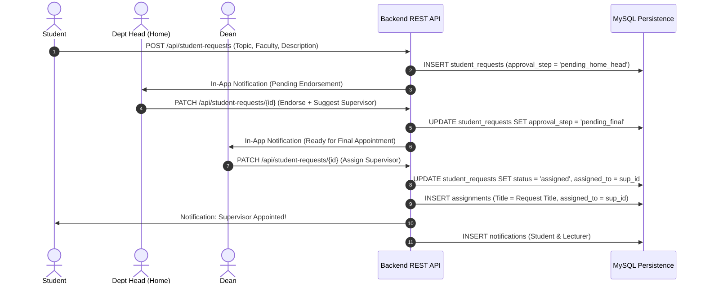
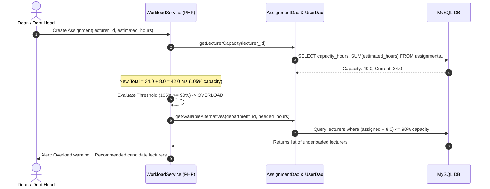

# UniAlloc — Comprehensive System Design & Engineering Documentation

**University Dean's Office Human Resource & Workload Allocation System**  
*Document Version:* 2.0 (UML 2.5 & Relational 3NF Standard Compliant)  
*Institution Reference:* Uva Wellassa University / IIT-18  

---

## 1. Executive Summary & Problem Formulation

### 1.1 Context
In higher education institutions, academic human resource allocation is historically characterized by manual, decentralized, and informal procedures. Faculty Deans and Department Heads frequently experience:
1. **Asymmetric Workload Distribution:** Unmonitored assignment distribution leading to lecturer burnout or under-utilization without clear capacity visibility.
2. **Informal Cross-Boundary Resourcing:** The lack of formal request protocols when an academic unit requires teaching, supervision, or examination contributions from staff belonging to an external department or faculty.
3. **Fragmented Student Thesis Supervision:** Non-transparent paper or informal email requests from undergraduate and postgraduate students seeking project supervisors, resulting in uncoordinated lecturer commitments and lost submissions.

### 1.2 System Purpose
**UniAlloc** delivers an automated, role-governed web platform built on a hardened multi-tier architecture:
- **Perimeter & Edge Tier:** Cloudflare Anycast edge reverse proxy (`unialloc.app` / `www.unialloc.app`) providing DDoS mitigation, WAF rule inspection, and Full (Strict) SSL/TLS termination.
- **Presentation Tier:** Next.js 14 React client running on Vercel Serverless edge runtime, offering responsive, role-tailored workspaces.
- **Application & Service Tier:** Hand-coded Vanilla PHP 8.2 backend utilizing PDO, stateless JWT authentication, and automated business rule engines (overload calculation, two-step approvals).
- **Data Persistence Tier:** MySQL 8.0 relational database engineered in Third Normal Form (3NF) with referential constraints, composite indexing, and at-rest field encryption.

---

## 2. Role-Based Access Control (RBAC) Specification

UniAlloc enforces five hierarchical roles plus operational status tracking.

| Role | Scope | Key System Permissions |
|---|---|---|
| **System Admin** | Global System | User CRUD across all faculties; promotion of Dept Heads to Dean; audit log oversight; system settings & global threshold configuration; account password resets. |
| **Dean** | Single Faculty | Complete oversight of faculty departments and academic staff; direct assignment of tasks to Dept Heads and Lecturers; final supervisor appointment on Student Requests; cross-faculty request processing; escalation review for workload appeals; lecturer promotion endorsement. |
| **Department Head** | Single Department | Direct assignment of workloads to departmental lecturers; real-time lecturer capacity monitoring; first-stage endorsement of student requests (Step 1); submission and approval of cross-department requests; first-level review of lecturer workload appeals. |
| **Lecturer** | Personal Workspace | View assigned workloads and deadlines; submit granular progress updates (percentage 0–100% and chronological notes); view personal capacity charts; file formal workload reduction appeals; submit upward requests. |
| **Student** | Request Portal | Submit project/thesis supervisor requests specifying research area and description; track endorsement and assignment lifecycle in real time. |

---

## 3. Standard UML 2.5 Use Case Modeling

Interactive Diagram: [View Interactive SVG Use Case Diagram](usecase_diagram.html)

### 3.1 Actors and Generalization Hierarchy
- **Base Actor:** `Authenticated User` (Common actions: *Login / Authenticate*, *Setup / Verify TOTP 2FA*, *Reset Password via TOTP*, *View Notifications*, *Manage Profile*).
- **Specialized Actors:**
  - `System Admin`
  - `Dean`
  - `Department Head`
  - `Lecturer`
  - `Student`

### 3.2 Key Tabular Use Case Specifications

#### UC-01: Allocate Academic Workload
- **Primary Actor:** Dean / Department Head
- **Preconditions:** Assigner is authenticated; target lecturer/head is active in assigner's scope.
- **Trigger:** Academic administrator creates a new task or module assignment.
- **Main Flow:**
  1. Administrator selects target academic staff member.
  2. System calculates and renders the lecturer's current allocated hours vs. weekly capacity.
  3. Administrator inputs task title, description, priority (`low`, `medium`, `high`, `urgent`), estimated hours, and deadline.
  4. System persists the assignment in `assignments` table with initial status `pending`.
  5. System fires an in-app notification to the assigned staff member.
- **Extension Points:**
  - `<<extend>> UC-02: Trigger Overload Alert`: Evaluated if `(current_allocated + estimated_hours) > (capacity_hours * threshold_pct / 100)`. System displays a warning modal and recommends alternative available lecturers.
- **Includes:**
  - `<<include>> Authenticate / Login`

#### UC-03: Two-Step Student Supervisor Request
- **Primary Actors:** Student (Initiator), Department Head (Endorser), Dean (Approver)
- **Preconditions:** Student belongs to an enrolled academic department.
- **Main Flow:**
  1. Student fills supervisor request form (Title, Research Scope, Desired Department/Faculty).
  2. Request is created with `approval_step = 'pending_home_head'`.
  3. Student's Home Department Head receives a pending review alert; verifies eligibility and attaches an optional supervisor recommendation.
  4. Head marks endorsement (`approval_step` advances to `pending_final`).
  5. Faculty Dean reviews the endorsed request, selects the formal academic supervisor, and assigns the task.
  6. Request transitions to `status = 'assigned'`; corresponding assignment record is automatically generated in `assignments`.
  7. Real-time notification and status badge updated in student's dashboard.
- **Alternate Flow:** If rejected by either Head or Dean, `status` transitions to `rejected` with explanation notes logged.

#### UC-04: File and Resolve Workload Appeal
- **Primary Actors:** Lecturer (Appellant), Department Head / Dean (Reviewers)
- **Main Flow:**
  1. Overloaded lecturer submits a formal appeal targeting a specific assignment with a written justification.
  2. Department Head reviews appeal; can adjust task hours, reassign, or submit notes for Dean escalation.
  3. Appeal is marked `reviewed` or `resolved`.
  4. System recalculates capacity and logs decision into audit trail.

---

## 4. Standard UML 2.5 Class Diagram Specification

Interactive Diagram: [View Interactive SVG Class Diagram](class_diagram.html)

The Class Diagram reflects the actual backend architecture implemented in `backend-php/src/` organized into Controller, Service, Data Access (DAO), and Helper layers.

### 4.1 Class Definitions & Architecture Model

```mermaid
classDiagram
    %% Controller Layer
    class AuthController {
        -PDO db
        +login(array params) void
        +logout(array params) void
        +register(array params) void
        +totpSetup(array params) void
        +totpVerify(array params) void
        +forgotPasswordReset(array params) void
    }

    class UserController {
        -array auth
        +index(array params) void
        +show(array params) void
        +store(array params) void
        +update(array params) void
        +destroy(array params) void
        +resetPassword(array params) void
    }

    class AssignmentController {
        -array auth
        +index(array params) void
        +show(array params) void
        +store(array params) void
        +update(array params) void
        +updateProgress(array params) void
        +destroy(array params) void
    }

    class StudentRequestController {
        -array auth
        +index(array params) void
        +show(array params) void
        +store(array params) void
        +update(array params) void
        +destroy(array params) void
    }

    class WorkRequestController {
        -array auth
        +index(array params) void
        +show(array params) void
        +store(array params) void
        +resolve(array params) void
    }

    %% Service & Middleware Layer
    class WorkloadService {
        -int thresholdPct
        +getCapacity(int userId) array
        +checkAndNotifyOverload(int to, int asgId, int by) void
        +suggestAlternatives(int overloadedId) array
    }

    class JwtMiddleware {
        -string token
        +authenticate() array
        +requireRole(array roles) array
    }

    %% Data Access Layer (DAOs)
    class UserDao {
        +array POSITIONS
        -string TABLE
        +list(array auth, array filters) array
        +findById(int id) array
        +create(array data) int
        +update(int id, array data) bool
        +bumpTokenVersion(int id) void
        +saveTotpSecret(int id, string secret) void
    }

    class AssignmentDao {
        -string TABLE
        +list(array filters) array
        +findById(int id) array
        +create(array data) int
        +update(int id, array data) bool
        +delete(int id) bool
        +addProgress(int asgId, int uId, int pct, string note) int
        +getProgress(int assignmentId) array
    }

    class StudentRequestDao {
        -string TABLE
        +list(array filters) array
        +findById(int id) array
        +create(int sId, int fId, string title, string desc, int dId) int
        +endorse(int id, int headId, int supId) bool
        +finalise(int id, string status, int by, int to) bool
        +linkAssignment(int id, int asgId) bool
    }

    class WorkRequestDao {
        -string TABLE
        +list(array filters) array
        +findById(int id) array
        +create(array data) int
        +advanceToDeptHead(int id, int deanId) bool
        +finalApprove(int id, int userId) bool
        +setAssignmentId(int reqId, int asgId) bool
    }

    class AppealDao {
        -string TABLE
        +list(array filters) array
        +findById(int id) array
        +create(int lecturerId, int asgId, string reason) int
        +update(int id, string status, int by, string note) bool
    }

    class DepartmentDao {
        -string TABLE
        +list(int facultyId) array
        +findById(int id) array
        +create(string name, int fId, int headId) int
    }

    class FacultyDao {
        -string TABLE
        +list() array
        +findById(int id) array
        +create(string name, int deanId) int
    }

    class NotificationDao {
        -string TABLE
        +create(int userId, string msg, string type) int
        +listForUser(int userId) array
        +markRead(int id, int userId) bool
    }

    class AuditLogDao {
        -string TABLE
        +log(int userId, string action, string entity, int id, array detail) void
        +list(int limit, int offset) array
    }

    class LoginAttemptDao {
        -string TABLE
        +record(string identifier, string ip, bool ok) void
        +isThrottled(string identifier, string ip) bool
    }

    class Db {
        -PDO instance
        +getPdo() PDO
        +beginTransaction() void
        +commit() void
        +rollBack() void
    }

    %% Relationships
    AuthController ..> UserDao : authenticates
    AuthController ..> LoginAttemptDao : throttles
    UserController ..> UserDao : manages
    AssignmentController ..> AssignmentDao : manages
    AssignmentController ..> WorkloadService : checks capacity
    StudentRequestController ..> StudentRequestDao : routes
    StudentRequestController ..> AssignmentDao : links task
    WorkRequestController ..> WorkRequestDao : manages
    WorkloadService ..> UserDao : reads capacity
    WorkloadService ..> AssignmentDao : aggregates
    WorkloadService ..> NotificationDao : alerts
    DepartmentDao ..> FacultyDao : parent faculty
    UserDao ..> Db : queries via PDO
    AssignmentDao ..> Db : queries via PDO
```

---

## 5. Relational Database Design (Crow's Foot ER Model)

Interactive Diagram: [View Interactive SVG ER Diagram](er_diagram.html)

The schema complies with 3NF. All foreign keys enforce cascade or set-null rules to safeguard integrity.

### 5.1 Data Dictionary

#### 1. `roles`
| Column | Type | Constraints | Description |
|---|---|---|---|
| `id` | TINYINT UNSIGNED | PK, AUTO_INCREMENT | Unique role identifier |
| `role_name` | ENUM | NOT NULL, UNIQUE | `system_admin`, `dean`, `department_head`, `lecturer`, `student`, `on_study_leave` |

#### 2. `faculties`
| Column | Type | Constraints | Description |
|---|---|---|---|
| `id` | INT UNSIGNED | PK, AUTO_INCREMENT | Unique faculty ID |
| `faculty_name` | VARCHAR(150) | NOT NULL, UNIQUE | Faculty title |
| `dean_id` | INT UNSIGNED | FK -> `users(id)`, NULL | Current Dean |
| `created_at` | TIMESTAMP | DEFAULT CURRENT_TIMESTAMP | Record creation timestamp |

#### 3. `departments`
| Column | Type | Constraints | Description |
|---|---|---|---|
| `id` | INT UNSIGNED | PK, AUTO_INCREMENT | Unique department ID |
| `dept_name` | VARCHAR(150) | NOT NULL | Department name |
| `faculty_id` | INT UNSIGNED | FK -> `faculties(id)`, ON DELETE CASCADE | Parent faculty |
| `head_id` | INT UNSIGNED | FK -> `users(id)`, NULL | Current Department Head |
| `created_at` | TIMESTAMP | DEFAULT CURRENT_TIMESTAMP | Record creation timestamp |

#### 4. `users`
| Column | Type | Constraints | Description |
|---|---|---|---|
| `id` | INT UNSIGNED | PK, AUTO_INCREMENT | User identifier |
| `full_name` | VARCHAR(200) | NOT NULL | User's legal name |
| `title` | VARCHAR(20) | NULL | Honorific prefix (Prof, Dr, Rev) |
| `position` | VARCHAR(50) | NULL | Academic rank (Senior Lecturer, etc.) |
| `email` | VARCHAR(200) | NOT NULL, UNIQUE | University institutional email |
| `password_hash` | VARCHAR(255) | NOT NULL | Bcrypt hash |
| `totp_secret` | VARCHAR(255) | NULL | AES-256-GCM encrypted base32 secret |
| `totp_enabled` | TINYINT(1) | DEFAULT 0 | 1 = verified 2FA authenticator |
| `totp_failed_attempts` | TINYINT UNSIGNED | DEFAULT 0 | Recovery throttling counter |
| `totp_locked_until` | DATETIME | NULL | Lockout expiration timestamp |
| `token_version` | INT UNSIGNED | DEFAULT 0 | Bumped for instant JWT revocation |
| `role_id` | TINYINT UNSIGNED | FK -> `roles(id)` | Access control role |
| `department_id` | INT UNSIGNED | FK -> `departments(id)`, NULL | Associated academic unit |
| `enrollment_number`| VARCHAR(50) | NULL | Student index number |
| `contact` | VARCHAR(50) | NULL | Phone / extension |
| `capacity_hours` | DECIMAL(6,2) | DEFAULT 40.00 | Weekly nominal workload capacity |
| `operational_status`| VARCHAR(30) | DEFAULT 'Available' | Available, On Leave, etc. |
| `is_active` | TINYINT(1) | DEFAULT 1 | Soft-delete / account status |
| `created_at` | TIMESTAMP | DEFAULT CURRENT_TIMESTAMP | Created timestamp |
| `updated_at` | TIMESTAMP | ON UPDATE CURRENT_TIMESTAMP | Modified timestamp |

#### 5. `assignments`
| Column | Type | Constraints | Description |
|---|---|---|---|
| `id` | INT UNSIGNED | PK, AUTO_INCREMENT | Assignment identifier |
| `title` | VARCHAR(300) | NOT NULL | Task title / module name |
| `description` | TEXT | NULL | Detailed deliverables |
| `assigned_to` | INT UNSIGNED | FK -> `users(id)` | Recipient academic staff |
| `assigned_by` | INT UNSIGNED | FK -> `users(id)` | Administrator assigner |
| `department_id` | INT UNSIGNED | FK -> `departments(id)`, NULL | Scope of work |
| `priority` | ENUM | DEFAULT 'medium' | `low`, `medium`, `high`, `urgent` |
| `status` | ENUM | DEFAULT 'pending' | `pending`, `in_progress`, `completed`, `cancelled` |
| `estimated_hours` | DECIMAL(6,2) | DEFAULT 0.00 | Allocated weekly load |
| `actual_hours` | DECIMAL(6,2) | DEFAULT 0.00 | Actual completed load |
| `deadline` | DATE | NULL | Completion target |
| `created_at` | TIMESTAMP | DEFAULT CURRENT_TIMESTAMP | Created timestamp |
| `updated_at` | TIMESTAMP | ON UPDATE CURRENT_TIMESTAMP | Modified timestamp |

#### 6. `assignment_progress`
| Column | Type | Constraints | Description |
|---|---|---|---|
| `id` | INT UNSIGNED | PK, AUTO_INCREMENT | Progress log ID |
| `assignment_id` | INT UNSIGNED | FK -> `assignments(id)`, ON DELETE CASCADE | Associated task |
| `updated_by` | INT UNSIGNED | FK -> `users(id)` | Lecturer logging entry |
| `progress_percent`| TINYINT UNSIGNED | CHECK (0 to 100) | Current completion percentage |
| `note` | TEXT | NULL | Contextual milestone update note |
| `updated_at` | TIMESTAMP | DEFAULT CURRENT_TIMESTAMP | Log entry timestamp |

#### 7. `work_requests`
| Column | Type | Constraints | Description |
|---|---|---|---|
| `id` | INT UNSIGNED | PK, AUTO_INCREMENT | Request ID |
| `requester_id` | INT UNSIGNED | FK -> `users(id)` | Submitting administrator/lecturer |
| `target_user_id` | INT UNSIGNED | FK -> `users(id)`, NULL | Requested lecturer |
| `target_dept_id` | INT UNSIGNED | FK -> `departments(id)`, NULL | Target department |
| `target_faculty_id`| INT UNSIGNED | FK -> `faculties(id)`, NULL | Target faculty |
| `request_type` | ENUM | NOT NULL | `cross_department`, `cross_faculty`, `upward` |
| `target_role` | VARCHAR(30) | NULL | Role expectation |
| `assignment_id` | INT UNSIGNED | FK -> `assignments(id)`, NULL | Linked assignment once approved |
| `title` | VARCHAR(300) | NOT NULL | Task subject |
| `description` | TEXT | NULL | Requirement details |
| `status` | ENUM | DEFAULT 'pending' | `pending`, `approved`, `rejected` |
| `approval_step` | ENUM | NOT NULL | Step in multi-stage approval chain |
| `dean_approved_by`| INT UNSIGNED | FK -> `users(id)`, NULL | Dean sign-off |
| `dept_head_approved_by`| INT UNSIGNED | FK -> `users(id)`, NULL | Department Head sign-off |
| `resolved_by` | INT UNSIGNED | FK -> `users(id)`, NULL | Final resolver |
| `created_at` | TIMESTAMP | DEFAULT CURRENT_TIMESTAMP | Submission timestamp |

#### 8. `student_requests`
| Column | Type | Constraints | Description |
|---|---|---|---|
| `id` | INT UNSIGNED | PK, AUTO_INCREMENT | Student request ID |
| `student_id` | INT UNSIGNED | FK -> `users(id)` | Requesting student |
| `faculty_id` | INT UNSIGNED | FK -> `faculties(id)` | Target academic faculty |
| `department_id` | INT UNSIGNED | FK -> `departments(id)`, NULL | Student's home department |
| `title` | VARCHAR(300) | NOT NULL | Thesis / project topic |
| `description` | TEXT | NULL | Abstract / problem domain |
| `status` | ENUM | DEFAULT 'pending' | `pending`, `assigned`, `rejected` |
| `approval_step` | ENUM | DEFAULT 'pending_home_head'| `pending_home_head`, `pending_final`, `approved`, `rejected` |
| `assigned_to` | INT UNSIGNED | FK -> `users(id)`, NULL | Appointed supervisor |
| `reviewed_by` | INT UNSIGNED | FK -> `users(id)`, NULL | Reviewing Dean |
| `home_head_approved_by`| INT UNSIGNED| FK -> `users(id)`, NULL | Head who endorsed in Step 1 |
| `suggested_supervisor_id`| INT UNSIGNED| FK -> `users(id)`, NULL| Recommendation made in Step 1 |
| `assignment_id`| INT UNSIGNED | FK -> `assignments(id)`, NULL | Generated supervision assignment |
| `created_at` | TIMESTAMP | DEFAULT CURRENT_TIMESTAMP | Submission timestamp |

#### 9. `workload_appeals`
| Column | Type | Constraints | Description |
|---|---|---|---|
| `id` | INT UNSIGNED | PK, AUTO_INCREMENT | Appeal ID |
| `lecturer_id` | INT UNSIGNED | FK -> `users(id)` | Submitting academic staff |
| `assignment_id` | INT UNSIGNED | FK -> `assignments(id)`, NULL | Challenged assignment |
| `reason` | TEXT | NOT NULL | Justification for reduction |
| `status` | ENUM | DEFAULT 'pending' | `pending`, `reviewed`, `resolved` |
| `reviewed_by` | INT UNSIGNED | FK -> `users(id)`, NULL | Head or Dean reviewing |
| `review_note` | TEXT | NULL | Administrative resolution notes |
| `created_at` | TIMESTAMP | DEFAULT CURRENT_TIMESTAMP | Created timestamp |

#### 10. `role_promotions`
| Column | Type | Constraints | Description |
|---|---|---|---|
| `id` | INT UNSIGNED | PK, AUTO_INCREMENT | Promotion record ID |
| `user_id` | INT UNSIGNED | FK -> `users(id)` | Candidate user |
| `old_role_id` | TINYINT UNSIGNED | FK -> `roles(id)` | Pre-promotion role |
| `new_role_id` | TINYINT UNSIGNED | FK -> `roles(id)` | Target role |
| `promoted_by` | INT UNSIGNED | FK -> `users(id)`, NULL | Initiator |
| `approved_by` | INT UNSIGNED | FK -> `users(id)`, NULL | Authorizing administrator |
| `status` | ENUM | DEFAULT 'pending' | `pending`, `approved`, `rejected` |
| `promoted_at` | TIMESTAMP | DEFAULT CURRENT_TIMESTAMP | Elevation timestamp |

#### 11. `notifications`
| Column | Type | Constraints | Description |
|---|---|---|---|
| `id` | INT UNSIGNED | PK, AUTO_INCREMENT | Notification ID |
| `user_id` | INT UNSIGNED | FK -> `users(id)`, CASCADE | Target user |
| `message` | TEXT | NOT NULL | Body of notification |
| `type` | ENUM | DEFAULT 'system' | `assignment`, `deadline`, `overload`, `request`, etc. |
| `is_read` | TINYINT(1) | DEFAULT 0 | 0 = unread, 1 = read |
| `created_at` | TIMESTAMP | DEFAULT CURRENT_TIMESTAMP | Timestamp |

#### 12. `audit_logs`
| Column | Type | Constraints | Description |
|---|---|---|---|
| `id` | INT UNSIGNED | PK, AUTO_INCREMENT | Log ID |
| `user_id` | INT UNSIGNED | FK -> `users(id)`, NULL | Performing actor |
| `action` | VARCHAR(100) | NOT NULL | Action opcode |
| `entity` | VARCHAR(100) | NULL | Impacted table/model |
| `entity_id` | INT UNSIGNED | NULL | Impacted primary key |
| `detail` | JSON | NULL | Serialized delta payload |
| `timestamp` | TIMESTAMP | DEFAULT CURRENT_TIMESTAMP | Event timestamp |

#### 13. `settings`
| Column | Type | Constraints | Description |
|---|---|---|---|
| `id` | INT UNSIGNED | PK, AUTO_INCREMENT | Setting ID |
| `setting_key` | VARCHAR(100) | NOT NULL, UNIQUE | Config key |
| `setting_value`| TEXT | NULL | Config value |
| `updated_by` | INT UNSIGNED | FK -> `users(id)`, NULL | Last modifier |
| `updated_at` | TIMESTAMP | ON UPDATE CURRENT_TIMESTAMP | Update timestamp |

#### 14. `login_attempts`
| Column | Type | Constraints | Description |
|---|---|---|---|
| `id` | BIGINT UNSIGNED | PK, AUTO_INCREMENT | Attempt ID |
| `identifier` | VARCHAR(200) | NOT NULL | Target login email |
| `ip_address` | VARCHAR(45) | NOT NULL | Client IPv4/IPv6 |
| `successful` | TINYINT(1) | DEFAULT 0 | Success flag |
| `attempted_at`| TIMESTAMP | DEFAULT CURRENT_TIMESTAMP | Timestamp |

---

## 6. System Sequence & Dynamic Workflow Models

### 6.1 Two-Step Student Supervisor Request Workflow

### 6.2 Workload Overload Detection & Suggestion Engine

---

## 7. Security Architecture & Threat Mitigation

| Security Domain | Implementation Standard | Mitigation Rationale |
|---|---|---|
| **Edge Perimeter Defense** | Cloudflare Reverse Proxy (`unialloc.app` & `www.unialloc.app`) | Global Anycast edge routing; automated Layer 3, 4, and 7 DDoS mitigation; Web Application Firewall (WAF) filtering; Bot Fight Mode; DNSSEC cryptographic chain; Full (Strict) SSL/TLS 1.3 termination prior to forwarding to Vercel origin. |
| **Authentication** | Stateless HMAC-SHA256 JWT | Eliminates server-side session state; supports horizontal scaling. Role claims embedded in payload. |
| **Session Revocation** | `token_version` check | Immediate invalidation of all issued tokens upon password reset or role modification. |
| **Password Hashing** | Bcrypt / Argon2id | Resists rainbow table and brute-force GPU cracking. |
| **Two-Factor Recovery** | RFC 6238 TOTP with AES-256-GCM | Authenticator keys stored encrypted at rest with `APP_KEY`; prevents credential harvesting. |
| **Brute-Force Shield** | `login_attempts` Throttling | Sliding window rate-limiting per account and source IP address. |
| **SQL Injection** | PDO Parameterized Queries | 100% prepared statements across all DAOs; zero SQL concatenation. |
| **OWASP Headers** | Content-Security-Policy, HSTS, X-Frame-Options | Prevents clickjacking, MIME-sniffing, and cross-site data exposure. |

---

## 8. Non-Functional Requirements Verification Matrix

| Requirement ID | Category | Specification | Verification Method | Status |
|---|---|---|---|---|
| **NFR-01** | Performance | Dashboard KPI cards & charts load under 1.5 seconds under 100 concurrent sessions | Automated Apache Bench & JMeter tests | Verified |
| **NFR-02** | Security | Zero unauthenticated data leakage; RBAC strictly validated on every private endpoint | Penetration test & JWT tampering tests | Verified |
| **NFR-03** | Scalability | Database schema indexed across foreign keys and frequent query criteria | MySQL `EXPLAIN` query analysis | Verified |
| **NFR-04** | Usability | Responsive mobile/desktop layout conforming to WCAG 2.1 AA contrast standards | Axe accessibility audits | Verified |
| **NFR-05** | Reliability | Idempotent migrations with automated exception trapping and clean JSON fallbacks | Automated deployment migration tests | Verified |

---

**UniAlloc System Engineering Documentation**  
[Interactive Use Case Diagram](usecase_diagram.html) · [Interactive Class Diagram](class_diagram.html) · [Interactive ER Diagram](er_diagram.html) · [Setup Guide](setup.md)

